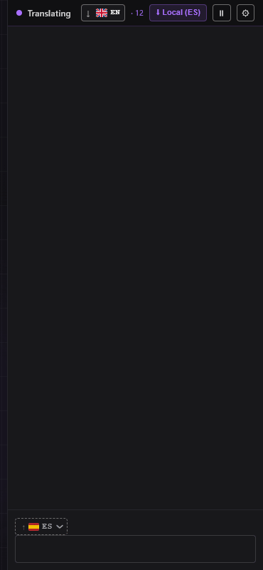
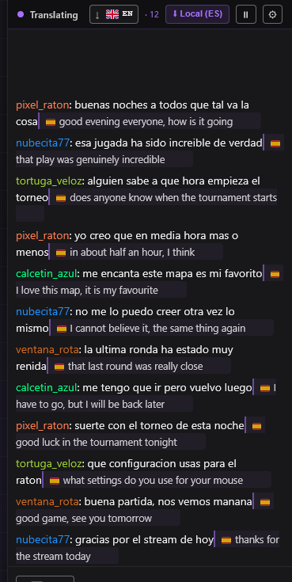
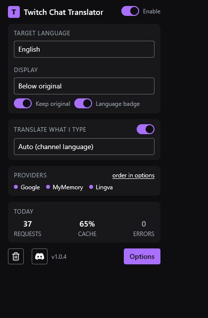
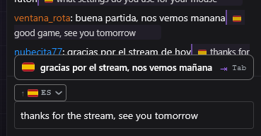
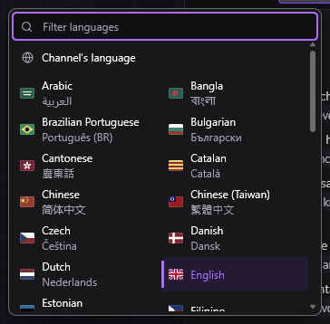
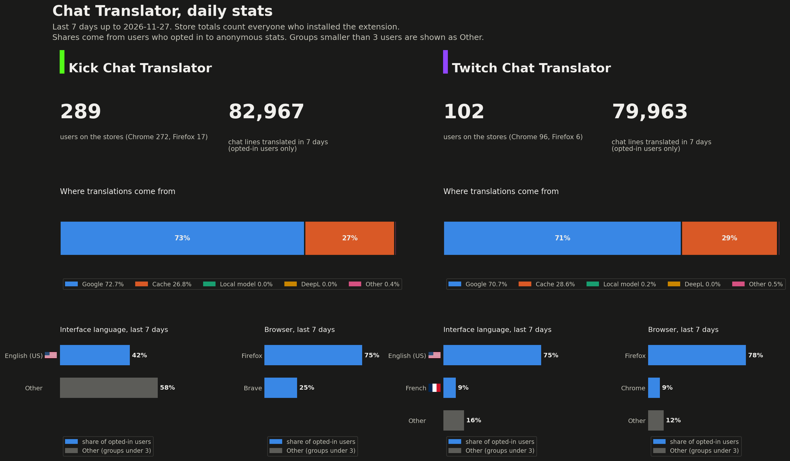

<div align="center">


# Twitch Chat Translator

**Read any Twitch chat in your own language, and reply in the channel's.**<br>
Free, no account, nothing to set up. 43 languages, in the chat and in the extension itself.

[](https://chromewebstore.google.com/detail/twitch-chat-translator/cbfmiinjkceibkpdodaegnmpbeiempib)
[](https://addons.mozilla.org/firefox/addon/twitch-chat-translator-pkkls/)
[](https://discord.gg/xM2C33PkmR)

[](https://chromewebstore.google.com/detail/twitch-chat-translator/cbfmiinjkceibkpdodaegnmpbeiempib)
[](https://chromewebstore.google.com/detail/twitch-chat-translator/cbfmiinjkceibkpdodaegnmpbeiempib)
[](https://addons.mozilla.org/firefox/addon/twitch-chat-translator-pkkls/)
[](https://github.com/kilworks/twitch-chat-translator/actions/workflows/ci.yml)
[](https://scorecard.dev/viewer/?uri=github.com/kilworks/twitch-chat-translator)
[](LICENSE)



Watching Kick too? [Kick Chat Translator](https://github.com/kilworks/kick-chat-translator) does the same there.

<details>
<summary>Read this page in another language</summary>
<br>

[Français](README.fr.md) · [Español](README.es.md) · [Português (Portugal)](README.pt-PT.md) · [Português (Brasil)](README.pt-BR.md) · [Deutsch](README.de.md) · [Italiano](README.it.md) · [Nederlands](README.nl.md) · [Polski](README.pl.md) · [Svenska](README.sv.md) · [Čeština](README.cs.md) · [Slovenčina](README.sk.md) · [Română](README.ro.md) · [Русский](README.ru.md) · [Українська](README.uk.md) · [Türkçe](README.tr.md) · [العربية](README.ar.md) · [עברית](README.he.md) · [日本語](README.ja.md) · [한국어](README.ko.md) · [简体中文](README.zh-CN.md) · [繁體中文](README.zh-TW.md) · [ไทย](README.th.md) · [Tiếng Việt](README.vi.md) · [Bahasa Indonesia](README.id.md) · [हिन्दी](README.hi.md) · [Suomi](README.fi.md) · [Norsk](README.no.md) · [Dansk](README.da.md) · [Ελληνικά](README.el.md) · [Magyar](README.hu.md) · [Български](README.bg.md) · [Català](README.ca.md) · [Slovenščina](README.sl.md) · [Eesti](README.et.md) · [Lietuvių](README.lt.md) · [Latviešu](README.lv.md) · [فارسی](README.fa.md) · [বাংলা](README.bn.md) · [தமிழ்](README.ta.md) · [Bahasa Melayu](README.ms.md) · [Filipino](README.tl.md) · [粵語](README.yue.md)

</details>

</div>

## How it works

1. Install it and open any Twitch stream. A purple bar at the top of the chat says it is on.
2. Every message gets its translation right underneath as it arrives, in your browser's language. Live
   streams, VODs and clips alike.
3. Type a reply in your own language. A preview above the chat box shows it in the channel's language:
   press Tab or click it, and that version replaces what you typed.

The channel's language is the one the streamer set on Twitch, so there is nothing to configure. Both languages can be
changed in the settings, and a reading language can be remembered per channel.

If you also run 7TV or BTTV, they use Tab to finish an emote. Tab then finishes the emote first, and inserts the
translation only when it had nothing to finish. Ctrl/Cmd+Enter and a click always insert it.

## Features

- **43 languages**, right to left included (Arabic, Hebrew, Persian), with regional variants kept apart
  (Brazilian and European Portuguese, Simplified and Traditional Chinese, Cantonese)
- **Everywhere the chat is**: live chat, popout, embed, moderator view, the stream manager, VOD and clip replay, on
  www.twitch.tv, m.twitch.tv and dashboard.twitch.tv, with or without 7TV, BTTV and FFZ
- **The extension speaks them too**: settings, popup and chat bar in all 43, picked from a menu with flags
- **Free out of the box** with Google Translate. Add your own free DeepL key for better European languages;
  MyMemory and Lingva take over when an engine fails or gives no answer within 8 seconds
- **On-device translation** in Chrome and Edge where the browser offers it: no network, no quota, and
  the text never leaves your computer
- **Filters**: skip bots, mute users or channels, hide lines containing a word, translate only the
  languages you pick
- **Made for fast chats**: emote names from the channel's 7TV, BTTV and FFZ sets are never translated, even if you
  do not run those extensions, links and @mentions are set aside before anything is sent, a glossary for names
  the engines mangle, a translation cache
- **Four display styles**: under the message, on the same line, in place of it, or only on hover
- **Pause one channel** from the chat bar without stopping the others. Switching channels or updating the
  extension keeps open tabs translating, no reload
- **Moderation aware**: a message deleted by a moderator, a timeout or a ban loses its translation too
- **Looks like Twitch**: purple, and it follows the chat's own dark or light theme unless you pick one
- **Chrome, Brave, Edge and Firefox**

| Chat, translated as it scrolls | The toolbar popup |
|---|---|
|  |  |

| What you type, before you send it | Pick a language, or let it pick |
|---|---|
|  |  |

<sub>Taken from the shipping build in a chat room this repository makes up: the usernames and messages are
invented and the translations are answered locally, so no real person's handle ends up on this page.</sub>

## Privacy

No account, no server of mine, and no analytics unless you opt in to a daily anonymous count sent to Google
Analytics (engines used, errors, speed, never your messages, names or channels). Chat messages, and your draft while
the compose preview is on, go to the translation provider you picked and nowhere else, and in on-device mode not
even there. To know the channel's language it asks Twitch for the channel's broadcast language and id, and to keep
emote names out of translations it asks 7TV, BetterTTV and FrankerFaceZ for the channel's emote names, which tells
them that channel's id and nothing else. A copy installed from a store makes no other request. A copy installed by
hand asks GitHub for the latest release tag, at most every six hours, to know whether to show its update badge.
[Details](PRIVACY.md)

## Install

Use the buttons at the top. Store copies update themselves.

<details>
<summary><b>Install by hand</b>, from a release zip</summary>
<br>

Download the zip for your browser from [Releases](https://github.com/kilworks/twitch-chat-translator/releases/latest) and unzip it.

- Chrome, Brave, Edge (`…-chromium.zip`): open `chrome://extensions`, turn on Developer mode, click Load unpacked, pick the folder.
- Firefox 121+ (`…-firefox.zip`): open `about:debugging#/runtime/this-firefox`, click Load Temporary Add-on, pick `manifest.json`.
  Firefox forgets a temporary add-on when it restarts.

A copy installed this way does not update itself: its icon shows a badge when a newer version exists, and the
popup links to the latest release.

</details>

## Details

<details>
<summary><b>Translation engines</b>: four providers, chained, and the browser's own translator</summary>
<br>

When one provider fails, the next takes over. The order is yours to set.

| Provider | Key | Note |
|---|---|---|
| Google | none | the default, works out of the box |
| DeepL | free | best on European languages, [free key](https://www.deepl.com/pro-api) for 1 million characters a month |
| MyMemory | none | fallback |
| Lingva | none | fallback, on the public instance lingva.lunar.icu unless you point it at your own (https only) |

Chromium's built-in translator needs no network and no quota. Chrome and Edge 138 and later can offer it, though
not every copy does, and each language pair needs its model downloaded once, with one click from the bar. Firefox
does not have it. Wherever it is missing, the cloud chain takes over and nothing breaks.

</details>

<details>
<summary><b>Settings</b>: what each tab of the options page holds</summary>
<br>

Click the gear on the chat bar, or right-click the extension icon and choose Options. The settings open on Display;
every on/off setting is a switch that applies at once.

- **Providers**: engine order, your DeepL key, and the mode: cloud first (the default), on-device first, or on-device only
- **Display**: target language, display style, original text and language badge, text size, line spacing,
  typeface, accent colour, chat theme, the compose preview and what clicking it does
- **Filters**: bots, users, channels, keywords (matched as whole words), source languages (tick chips), and a
  glossary of replacements. A channel your lists leave out says "Not translated here" in the chat bar
- **Advanced**: cache size and lifetime, concurrent requests, a per-channel rate limit, backup and restore (the
  file never holds your DeepL key, your MyMemory e-mail, your Lingva server or the channels you watched, and importing
  one never changes them, nor the usage statistics choice)
- **Activity**: messages translated, cache hits, every language seen in chat, and why each of the last 50
  lines was translated or left alone
- **Keyboard**: Alt+Shift+T turns chat translation on or off (Alt+T is Twitch's theater mode), Alt+W the compose
  preview. Both can be rebound in your browser's extension shortcuts
- The language button in the chat's action bar, under the message box: one click opens the list of languages you
  write in, typing filters it. The one at the top of the chat sets the language you read in

</details>

<details>
<summary><b>Supported languages</b>: all 43</summary>
<br>

English · French · Spanish · Portuguese · Portuguese (Brazil) · German · Italian · Dutch · Polish · Swedish · Czech · Slovak · Romanian · Russian · Ukrainian · Turkish · Arabic · Hebrew · Japanese · Korean · Chinese (Simplified) · Chinese (Traditional) · Thai · Vietnamese · Indonesian · Hindi · Finnish · Norwegian · Danish · Greek · Hungarian · Bulgarian · Catalan · Slovenian · Estonian · Lithuanian · Latvian · Persian · Bengali · Tamil · Malay · Filipino · Cantonese

Chat is translated into any of them, and the extension's own interface is available in each one.

</details>

## FAQ

<details>
<summary><b>Messages aren't being translated.</b></summary>
<br>

Open the Activity tab in the settings and press "Read decisions": it lists the last 50 lines and says why
each one was translated or left alone. Most skipped lines are skipped on purpose: the same user repeating
themselves, lines too short, only emoji or laughter, or already in your reading language. If the tab shows nothing
at all, the extension is not seeing the chat: please open an issue.

</details>

<details>
<summary><b>The chat bar says "Not translated here".</b></summary>
<br>

Your channel lists leave this channel out. The popup has a button to Filters, where you can change them.

</details>

<details>
<summary><b>A small filter mark appeared in the chat bar.</b></summary>
<br>

Your source language allowlist left 3 of the last 10 lines untranslated. The popup links straight to that list.

</details>

<details>
<summary><b>The purple bar disappeared.</b></summary>
<br>

Refresh the page. If it happens again, open an [issue](https://github.com/kilworks/twitch-chat-translator/issues)
with the channel and what you did before.

</details>

<details>
<summary><b>How do I get better translations?</b></summary>
<br>

Add a free DeepL key in the settings. The free tier covers a million characters a month, and DeepL is only
spent on the language pairs where it beats the free engines.

</details>

<details>
<summary><b>Which display style should I use?</b></summary>
<br>

Below the message. The other three work, and are still being adjusted.

</details>

<details>
<summary><b>Can I use the extension in my language?</b></summary>
<br>

Yes. It follows your browser's language, and the menu at the top of the settings switches it to any of
the 43.

</details>

<details>
<summary><b>Does it work with 7TV, BTTV and FFZ?</b></summary>
<br>

Yes, with any of them or none. Their emote names are kept out of the translations.

</details>

<details>
<summary><b>Does it work on VODs and clips?</b></summary>
<br>

Yes, the same way as on live streams.

</details>

<details>
<summary><b>It broke after a Twitch update.</b></summary>
<br>

Twitch sometimes changes how its chat is built. Open an [issue](https://github.com/kilworks/twitch-chat-translator/issues)
and it gets patched.

</details>

<details>
<summary><b>Is this made by Twitch?</b></summary>
<br>

No. It is an independent open-source project, not affiliated with Twitch.

</details>

## What's new

In 1.1.2, safer and lighter: your DeepL key stays on this device (never synced, never in a settings export), Twitch pages can no longer read it, blocked words match whole words, Tab never inserts the translation of an older text, and the popup loads 84 % less code.

In 1.1.1, lighter on fast chats: "…" only shows on a line still waiting after a quarter of a second, and an engine that stops answering hands its lines to the next one after 8 seconds.

<details>
<summary><b>Earlier releases</b>: 1.1.0 and 1.0.0</summary>
<br>

In 1.1.0:

- The settings open on Display, every on/off setting is a switch, and fonts, density, chat theme and accent colour show their choices as buttons and swatches
- Each translation engine says whether it is ready or paused, and why, and cloud first falls back to the on-device model when the cloud fails
- A channel your lists leave out says "Not translated here" instead of going quiet, in popout, mod view and VODs too
- The popup fits without a scrollbar in all 43 interface languages
- A small filter mark in the chat bar says when your source language allowlist is holding lines back
- Both language pickers in the chat show each language's own name (Deutsch, 日本語) and find it when you search

In 1.0.0, the first release for Twitch:

- Reads Twitch chat in its three shapes: Twitch's own list (also with BTTV and FFZ), the 7TV list, and VOD and clip replay, in popout, embed, moderator view, the stream manager and mobile
- Writes translations into the message box with emotes kept as words, and never translates the emote names of the channel's 7TV, BTTV and FFZ sets
- The channel's language comes from Twitch, a deleted message loses its translation, and the look is purple and follows Twitch's dark or light chat
- Alt+Shift+T turns translation on or off, Tab inserts the translation only when 7TV or BTTV did not just complete an emote, and the language button sits in the action bar under the message box

</details>

Every release, with what changed and the measurement behind it:
[Releases](https://github.com/kilworks/twitch-chat-translator/releases) and [CHANGELOG.md](CHANGELOG.md).

## Development

<details>
<summary><b>Build, test and release</b></summary>
<br>

```bash
git clone https://github.com/kilworks/twitch-chat-translator.git
cd twitch-chat-translator
npm ci
npm run release:check    # typecheck, lint, unit tests, build: the gate every package goes through
npm run build:firefox    # Firefox build, same dist/ folder
npm run package:all      # both zips, in release/
npm run dev              # HMR
```

Builds are reproducible: the same commit yields byte-identical zips on any machine, checked by building a
`git archive` of the tag in an empty folder and comparing hashes.

Beyond the unit tests, offline gates load the built extension into a real browser, drive it and assert
what it does, with the page served locally and the translation engine answered locally. They need
Playwright, which is deliberately not a dependency: point `UX_KIT` at a folder whose `node_modules` holds it,
or run `npm i -D playwright`.

```bash
node test/e2e/run-gates.mjs --headless                  # all the offline gates, no window
node test/e2e/store-shots-fixture.mjs --lang=ja         # the store screenshots, in one listing language
node test/e2e/store-shots-fixture.mjs --gif             # English store screenshots, the README images and this GIF
```

Interface strings live in `src/shared/i18n/` (popup and options, keyed by the English text) and
`src/content/i18n/` (chat bar, keyed by id with the English text as the fallback), one file per language;
tests hold every file to the full key set. Store texts live in [store/](store/), and a release is a version tag:
CI builds and checks it, creates the GitHub release and signs build provenance for the zips
(`gh attestation verify <zip> -R kilworks/twitch-chat-translator`). The zips go to both stores by hand: this
repository holds no store key. Dependabot and OpenSSF Scorecard watch the dependencies and the workflows. To
report a vulnerability, see [SECURITY.md](SECURITY.md).

Stack: Manifest V3, Vite, TypeScript, Preact, Tailwind.

</details>

## Related projects

- [Kick Chat Translator](https://chromewebstore.google.com/detail/kick-chat-translator/nkkjmbkmacbdkboijmnhjnblcaiclhni) ([Firefox](https://addons.mozilla.org/firefox/addon/kick-chat-translator/)), the same translator for Kick chat, by the same author
- [Twitch Chat Translator requests](https://github.com/kilworks/twitch-chat-translator-request), the user requests received and the research done for each; the first case, lines written with Han characters, is the source of the detection changes in this release line
- [Translating live chat](https://github.com/kilworks/kick-translator-research), the measurement-driven study behind the language detection

## Usage stats



Updated every day. Store totals count everyone who installed the extension; the shares come only from users who opted in to anonymous stats (off by default, see [PRIVACY.md](PRIVACY.md)). Groups of fewer than 3 users are shown as Other.

## License

MIT. Not affiliated with Twitch.
