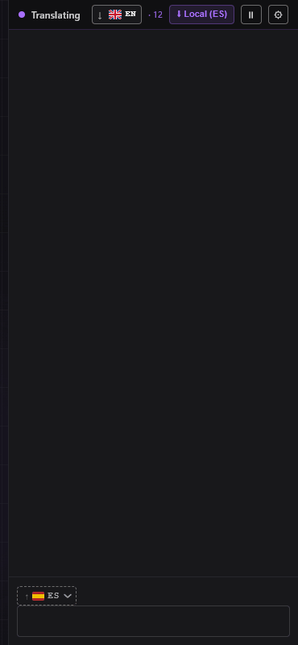
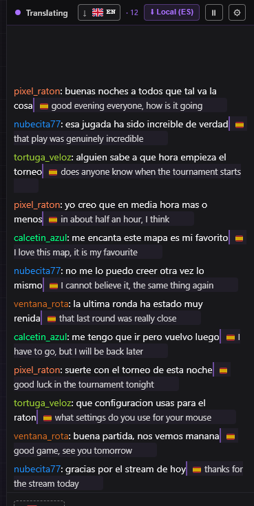
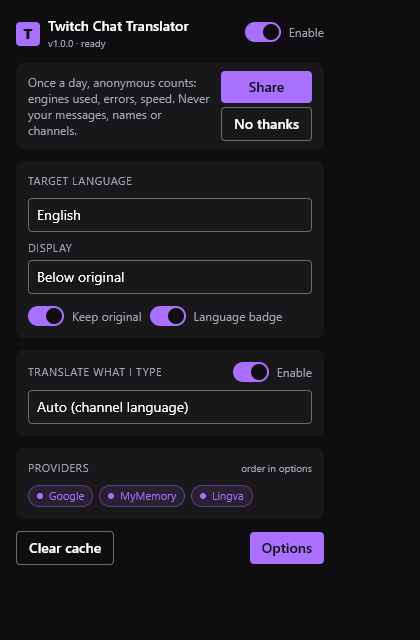
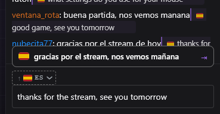
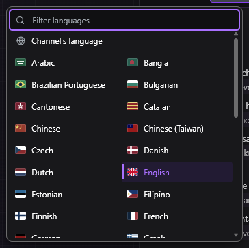

<div align="center">


# Twitch Chat Translator

Citește chatul oricărui stream de pe Twitch în limba ta și răspunde în limba canalului.<br>
Gratuit, fără cont, nimic de configurat. 43 de limbi, în chat și în extensia însăși.

**[Descarcă ultima versiune](https://github.com/kilworks/twitch-chat-translator/releases/latest)** &nbsp;·&nbsp; Chrome, Brave, Edge și Firefox

[](https://github.com/kilworks/twitch-chat-translator/actions/workflows/ci.yml)
[](LICENSE)

[English](README.md) · [Français](README.fr.md) · [Español](README.es.md) · [Português (Portugal)](README.pt-PT.md) · [Português (Brasil)](README.pt-BR.md) · [Deutsch](README.de.md) · [Italiano](README.it.md) · [Nederlands](README.nl.md) · [Polski](README.pl.md) · [Svenska](README.sv.md) · [Čeština](README.cs.md) · [Slovenčina](README.sk.md) · [Русский](README.ru.md) · [Українська](README.uk.md) · [Türkçe](README.tr.md) · [العربية](README.ar.md) · [עברית](README.he.md) · [日本語](README.ja.md) · [한국어](README.ko.md) · [简体中文](README.zh-CN.md) · [繁體中文](README.zh-TW.md) · [ไทย](README.th.md) · [Tiếng Việt](README.vi.md) · [Bahasa Indonesia](README.id.md) · [हिन्दी](README.hi.md) · [Suomi](README.fi.md) · [Norsk](README.no.md) · [Dansk](README.da.md) · [Ελληνικά](README.el.md) · [Magyar](README.hu.md) · [Български](README.bg.md) · [Català](README.ca.md) · [Slovenščina](README.sl.md) · [Eesti](README.et.md) · [Lietuvių](README.lt.md) · [Latviešu](README.lv.md) · [فارسی](README.fa.md) · [বাংলা](README.bn.md) · [தமிழ்](README.ta.md) · [Bahasa Melayu](README.ms.md) · [Filipino](README.tl.md) · [粵語](README.yue.md)



</div>

## Cum funcționează

1. Instalează-o și deschide orice stream de pe Twitch. O bară violet în partea de sus a chatului arată că e pornită.
2. Fiecare mesaj primește traducerea chiar dedesubt, pe măsură ce sosește, în limba browserului tău. La fel la
   streamurile live, la VOD-uri și la clipuri.
3. Scrie un răspuns în limba ta. O previzualizare deasupra casetei de chat îl arată în limba canalului:
   apasă Tab sau dă clic pe ea, iar varianta aceea înlocuiește ce ai scris.

Limba canalului e cea setată de streamer pe Twitch, așa că nu ai nimic de configurat. Ambele limbi se pot schimba din
setări, iar limba de citire poate fi ținută minte separat pentru fiecare canal.

Dacă folosești și 7TV sau BTTV, ele folosesc Tab ca să termine un emote. Tab termină atunci întâi emote-ul și inserează traducerea doar când nu era nimic de terminat. Ctrl/Cmd+Enter și un clic o inserează mereu.

## Ce primești

- **43 de limbi**, inclusiv cele scrise de la dreapta la stânga (araba, ebraica, persana), cu variantele
  regionale păstrate separat (portugheza braziliană și cea europeană, chineza simplificată și cea tradițională,
  cantoneza)
- **Peste tot unde e chat**: chat live, popout, chat încorporat, vizualizarea de moderator, stream manager, reluări de VOD și de clipuri, pe
  www.twitch.tv, m.twitch.tv și dashboard.twitch.tv, cu sau fără 7TV, BTTV și FFZ
- **Extensia le vorbește și ea**: setările, fereastra popup și bara din chat sunt în toate cele 43, alese dintr-un
  meniu cu steaguri
- **Gratuit din prima** cu Google Translate. Adaugă propria cheie DeepL gratuită pentru limbi europene mai bune;
  MyMemory și Lingva preiau când un motor cade
- **Traducere pe dispozitiv** în Chrome și Edge, acolo unde o oferă browserul: fără rețea, fără cotă, iar textul
  nu iese niciodată din calculatorul tău
- **Filtre**: ignoră boții, dă mute utilizatorilor sau canalelor, ascunde rândurile care conțin un cuvânt, tradu
  doar limbile alese de tine
- **Făcut pentru chaturi rapide**: numele emote-urilor din seturile 7TV, BTTV și FFZ ale canalului nu se traduc
  niciodată, chiar dacă nu folosești acele extensii, linkurile și @mențiunile sunt puse deoparte înainte să se
  trimită ceva, un glosar pentru nume pe care motoarele le strică, un cache de traduceri
- **Patru stiluri de afișare**: sub mesaj, pe același rând, în locul lui sau doar la trecerea cursorului
- **Pauză pe un singur canal** din bara chatului, fără să le oprești pe celelalte. Schimbarea canalului sau
  actualizarea extensiei lasă filele deschise să traducă în continuare, fără reîncărcare
- **Atent la moderare**: un mesaj șters de un moderator, un timeout sau un ban își pierde și traducerea
- **Arată ca Twitch**: violet, și urmează tema întunecată sau luminoasă a chatului, dacă nu alegi tu una
- Chrome, Brave, Edge și Firefox

| Chatul, tradus pe măsură ce derulează | Fereastra popup din bara de instrumente |
|---|---|
|  |  |

| Ce scrii, înainte să trimiți | Alege o limbă sau las-o să aleagă singură |
|---|---|
|  |  |

<sub>Capturile sunt făcute cu versiunea finală, într-o cameră de chat pe care acest repository o inventează:
numele de utilizator și mesajele sunt inventate, iar traducerile sunt răspunse local, așa că numele niciunei
persoane reale nu ajunge pe această pagină.</sub>

## Instalare

Descarcă zipul pentru browserul tău de la [Releases](https://github.com/kilworks/twitch-chat-translator/releases/latest) și dezarhivează-o.

- Chrome, Brave, Edge (`…-chromium.zip`): deschide `chrome://extensions`, pornește modul dezvoltator, dă clic pe Load unpacked și alege folderul.
- Firefox 121+ (`…-firefox.zip`): deschide `about:debugging#/runtime/this-firefox`, dă clic pe Load Temporary Add-on și alege `manifest.json`.
  Firefox uită un supliment temporar când repornește.

O copie instalată așa nu se actualizează singură: pictograma ei afișează o insignă când există o versiune mai
nouă, iar fereastra popup trimite la ultima versiune.

## Motoare de traducere

Patru servicii înlănțuite: când unul cade, îl preia următorul. Ordinea o stabilești tu.

| Serviciu | Cheie | Notă |
|---|---|---|
| Google | niciuna | cel implicit, merge din prima |
| DeepL | gratuită | cel mai bun pe limbile europene, [cheie gratuită](https://www.deepl.com/pro-api) pentru 1 milion de caractere pe lună |
| MyMemory | niciuna | de rezervă |
| Lingva | niciuna | de rezervă, pe o instanță publică, dacă nu îl îndrepți spre a ta |

Traducătorul integrat al Chromium nu are nevoie de rețea și nici de cotă. Chrome și Edge 138 și mai noi îl pot
oferi, deși nu toate copiile îl au, iar pentru fiecare pereche de limbi modelul trebuie descărcat o singură dată,
cu un clic din bară. Firefox nu îl are. Oriunde lipsește, preia lanțul din cloud și nimic nu se strică.

## Setări

Dă clic pe rotița din bara chatului sau clic dreapta pe pictograma extensiei și alege „Setări”.

- **Servicii**: ordinea motoarelor, cheia ta DeepL și modul: întâi pe dispozitiv, întâi cloud sau doar pe dispozitiv
- **Afișare**: limba țintă, stilul de afișare, textul original și eticheta limbii, dimensiunea textului,
  spațierea între rânduri, fontul, culoarea de accent, tema chatului, previzualizarea la scriere și ce face clicul pe ea
- **Filtre**: boți, utilizatori, canale, cuvinte-cheie, limbi sursă și un glosar de înlocuiri
- **Avansat**: dimensiunea și durata de viață a cache-ului, cereri simultane, o limită de cereri pe canal,
  copie de rezervă și restaurare
- **Activitate**: mesaje traduse, accesări ale cache-ului, fiecare limbă văzută în chat și de ce fiecare dintre
  ultimele 50 de rânduri a fost tradus sau lăsat în pace
- **Tastatură**: Alt+Shift+T pornește sau oprește traducerea chatului (Alt+T este modul teatru al Twitch), Alt+W
  previzualizarea la scriere. Ambele pot fi schimbate în scurtăturile extensiilor din browserul tău
- Butonul de limbă din bara de acțiuni a chatului, sub caseta de mesaj: un clic deschide lista limbilor în care
  scrii, tastarea o filtrează. Cel din partea de sus a chatului stabilește limba în care citești

## Limbi acceptate

engleză · franceză · spaniolă · portugheză · portugheză (Brazilia) · germană · italiană · olandeză · poloneză · suedeză · cehă · slovacă · română · rusă · ucraineană · turcă · arabă · ebraică · japoneză · coreeană · chineză (simplificată) · chineză (tradițională) · thailandeză · vietnameză · indoneziană · hindi · finlandeză · norvegiană · daneză · greacă · maghiară · bulgară · catalană · slovenă · estonă · lituaniană · letonă · persană · bengaleză · tamilă · malaeză · filipineză · cantoneză

Chatul se traduce în oricare dintre ele, iar interfața extensiei însăși este disponibilă în fiecare.

## Confidențialitate

Niciun cont, nici un server de-al meu și nicio analiză, cu excepția cazului în care vă înscrieți pentru un număr anonim zilnic trimis către Google Analytics (motoare utilizate, erori, viteză, niciodată mesajele, numele sau canalele dvs.). Mesajele din chat, și ciorna ta cât timp previzualizarea la scriere e pornită, merg la serviciul de traducere ales de tine și
nicăieri altundeva, iar în modul pe dispozitiv nici acolo. Ca să afle limba canalului, întreabă Twitch care e limba
de transmisie și id-ul canalului, iar ca să țină numele emote-urilor în afara traducerilor, întreabă 7TV, BetterTTV
și FrankerFaceZ numele emote-urilor canalului, ceea ce le spune id-ul acelui canal și nimic altceva. O copie instalată dintr-un magazin nu face nicio altă
cerere. O copie instalată manual întreabă GitHub care e ultimul tag de versiune, cel mult o dată la șase ore, ca
să știe dacă afișează insigna de actualizare. [Detalii](PRIVACY.md)

## Întrebări frecvente

**Mesajele nu se traduc.**
Deschide fila Activitate din setări și apasă „Citește deciziile”: listează ultimele 50 de rânduri și spune de ce
fiecare a fost tradus sau lăsat în pace. Cele mai multe rânduri sărite sunt sărite intenționat: același
utilizator care se repetă, rânduri prea scurte, doar emoji sau râsete, sau deja în limba ta de citire. Dacă fila nu arată nimic, extensia nu vede chatul: te rog deschide un issue.

**Bara violet a dispărut.**
Reîmprospătează pagina. Dacă se întâmplă din nou, deschide un [issue](https://github.com/kilworks/twitch-chat-translator/issues)
cu canalul și ce ai făcut înainte.

**Cum obțin traduceri mai bune?**
Adaugă o cheie DeepL gratuită în setări. Planul gratuit acoperă un milion de caractere pe lună, iar DeepL e
folosit doar pentru perechile de limbi la care întrece motoarele gratuite.

**Ce stil de afișare să folosesc?**
Sub mesaj. Celelalte trei merg, dar sunt încă în curs de ajustare.

**Pot folosi extensia în limba mea?**
Da. Urmează limba browserului, iar meniul din partea de sus a setărilor o schimbă în oricare dintre cele 43.

**Merge cu 7TV, BTTV și FFZ?**
Da, cu oricare dintre ele sau cu niciuna. Numele emote-urilor lor sunt ținute în afara traducerilor.

**Merge la VOD-uri și clipuri?**
Da, la fel ca la streamurile live.

**S-a stricat după o actualizare Twitch.**
Twitch își schimbă uneori felul în care e construit chatul. Deschide un [issue](https://github.com/kilworks/twitch-chat-translator/issues)
și se repară.

**E făcută de Twitch?**
Nu. E un proiect open-source independent, fără legătură cu Twitch.

## Noutăți

În 1.0.0, prima versiune pentru Twitch:

- Citește chatul Twitch în cele trei forme ale sale: lista proprie a Twitch (și cu BTTV și FFZ), lista 7TV și reluările de VOD și de clipuri, în popout, chat încorporat, vizualizarea de moderator, stream manager și pe mobil
- Scrie traducerile în caseta de mesaj cu emote-urile păstrate ca cuvinte și nu traduce niciodată numele emote-urilor din seturile 7TV, BTTV și FFZ ale canalului
- Limba canalului vine de la Twitch, un mesaj șters își pierde traducerea, iar aspectul e violet și urmează chatul întunecat sau luminos al Twitch
- Alt+Shift+T pornește sau oprește traducerea, Tab inserează traducerea doar când 7TV sau BTTV nu tocmai au terminat un emote, iar butonul de limbă e în bara de acțiuni de sub caseta de mesaj

Fiecare versiune, cu ce s-a schimbat și măsurătoarea din spate:
[Releases](https://github.com/kilworks/twitch-chat-translator/releases) și [CHANGELOG.md](CHANGELOG.md).

## Dezvoltare

```bash
git clone https://github.com/kilworks/twitch-chat-translator.git
cd twitch-chat-translator
npm ci
npm run release:check    # typecheck, lint, unit tests, build: the gate every package goes through
npm run build:firefox    # Firefox build, same dist/ folder
npm run package:all      # both zips, in release/
npm run dev              # HMR
```

Build-urile sunt reproductibile: același commit dă zipuri identice octet cu octet pe orice mașină, verificat
construind un `git archive` al tagului într-un folder gol și comparând hash-urile.

Pe lângă testele unitare, verificările offline încarcă extensia construită într-un browser real, o folosesc
și verifică ce face, cu pagina servită local și motorul de traducere răspunzând local. Au nevoie de Playwright,
care nu e dependență în mod deliberat: indică în `UX_KIT` un folder al cărui `node_modules` îl conține, sau
rulează `npm i -D playwright`.

```bash
node test/e2e/run-gates.mjs --headless                  # all the offline gates, no window
node test/e2e/store-shots-fixture.mjs --lang=ja         # the store screenshots, in one listing language
node test/e2e/store-shots-fixture.mjs --gif             # English store screenshots, the README images and this GIF
```

Textele interfeței stau în `src/shared/i18n/` (popup și setări, cu textul englezesc drept cheie) și în
`src/content/i18n/` (bara din chat, cu id drept cheie și textul englezesc ca rezervă), un fișier pe limbă;
testele cer fiecărui fișier setul complet de chei. Textele pentru magazine sunt în [store/](store/), iar o
versiune este un tag de versiune: CI-ul o construiește, o verifică și o publică în ambele magazine.

Stack: Manifest V3, Vite, TypeScript, Preact, Tailwind.

## Proiecte înrudite

- [Kick Chat Translator](https://chromewebstore.google.com/detail/kick-chat-translator/nkkjmbkmacbdkboijmnhjnblcaiclhni) ([Firefox](https://addons.mozilla.org/firefox/addon/kick-chat-translator/)), același traducător pentru chatul Kick, de același autor

## Licență

MIT. Fără legătură cu Twitch.
